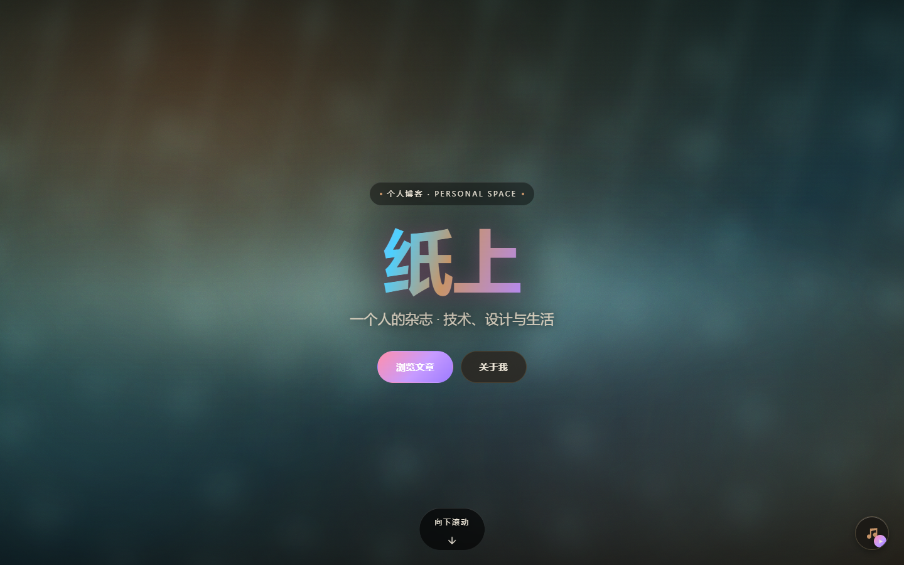
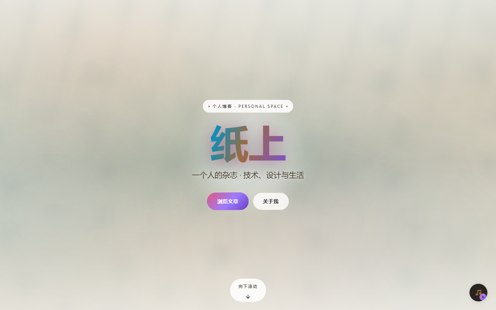
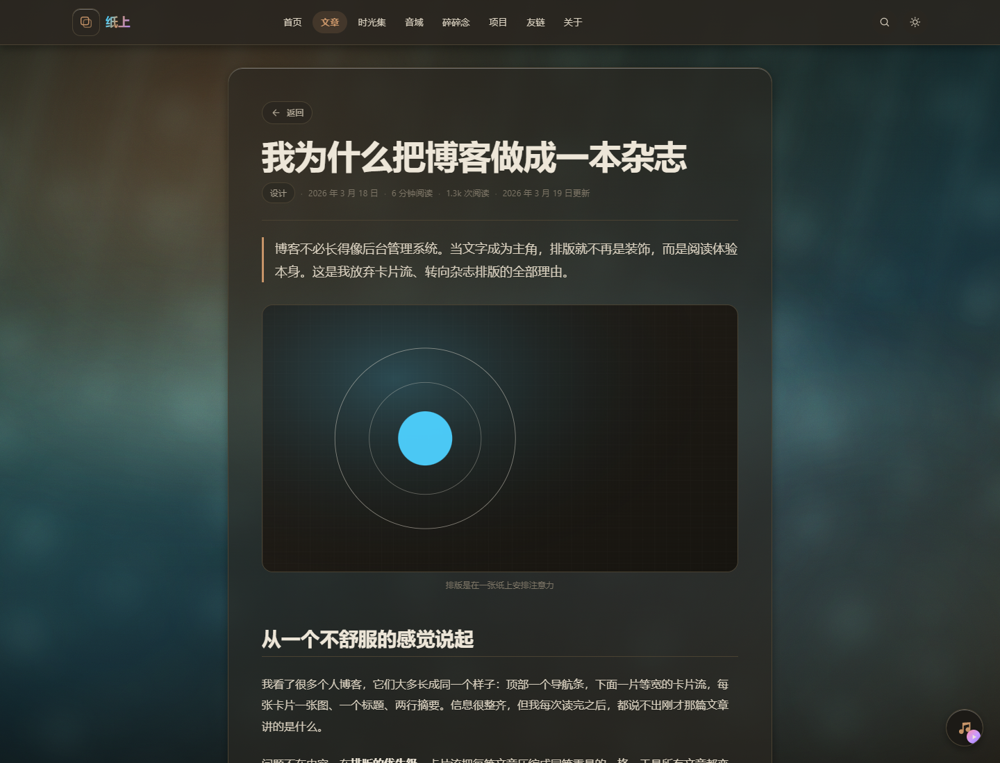
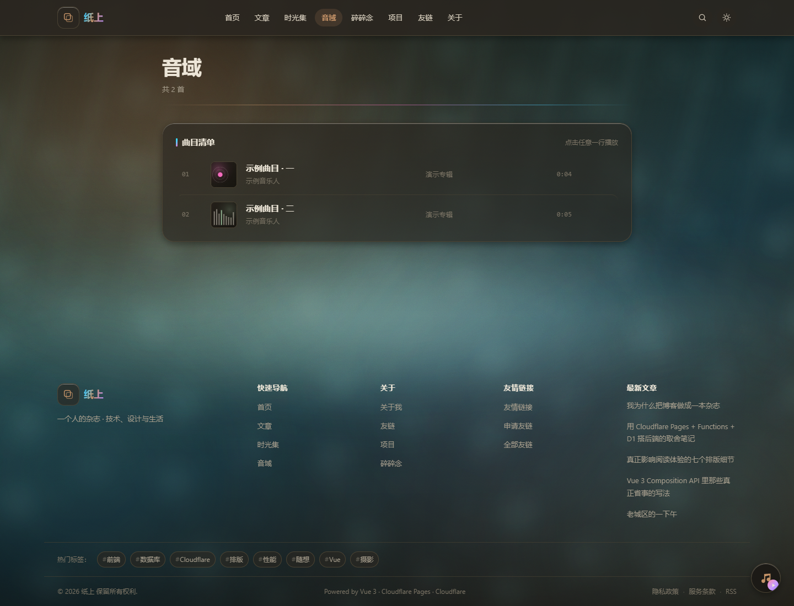

# 个人博客

> 🚀 **想部署一个自己的？直接看 [docs/deployment.md](docs/deployment.md)** —— 照着点即可，
> 全程免费额度、不需要先买域名。
>
> 📌 **改代码前建议先跑一遍 [四项验证](#常用命令)**（类型检查 + 356 项接口断言 + 构建），确认基线健康。

**Vue 3 公开站 + 管理后台 + Cloudflare Pages Functions + D1 + R2**，
一个**部署在 Cloudflare 免费额度内、月费 $0** 的全功能个人博客。

架构复刻自 [zhici.cc.cd](https://zhici.cc.cd/)（Vue 3 SPA + Pages Functions + D1 + 独立 admin），
**视觉风格也对齐该站**：暖调深色底 + 霓虹渐变 + 玻璃拟态卡片 + 照片质感背景。

> 版权说明：只复刻**设计语言与架构思路**（配色、渐变、卡片规范、栅格、交互模式）。
> 品牌名、吉祥物图片、照片，以及全部文章正文都是自己的内容，由后台设置控制。

---

## 一、这个项目解决什么问题

个人博客常见两种形态：**静态生成器 + 一堆第三方服务**，或**一台服务器 + WordPress**。
两种都有各自的摩擦点。这个项目针对的是下面这些具体问题：

| 具体问题 | 这个项目的做法 |
|---|---|
| 静态博客改一篇文章要重新构建、重新部署 | 内容存 D1，后台改完**立刻生效**，不需要重新构建 |
| 动态博客要一台服务器 + 数据库，有固定月费 | 全托管在 Cloudflare Pages + D1 + R2，**Free 套餐 $0/月**（代码里带免费额度守卫） |
| 前后端两套代码、要部署两次 | **同一个 Pages 项目**：Vue SPA + Functions API + 后台共用一份 `_lib` |
| 没有域名就没法开始 | Pages 自带 `xxx.pages.dev`，HTTPS 与公网访问开箱可用，**可以先跑起来再考虑域名** |
| Workers Free 只有 10 ms CPU，标准强度密码哈希（PBKDF2 600k ≈ 75 ms）根本跑不动 | 慢哈希**放到浏览器算**，服务端只做一次亚毫秒级 HMAC（见「鉴权设计」） |
| 后台内容类型越加越多，每加一类就要手写一套页面 | **声明式**：服务端 `_lib/resources.ts` 声明字段白名单，前端 `admin/resources.ts` 声明控件，表格与表单自动生成 |
| 上线前不敢确认接口是否正确 | `npm run verify:api` 直接调用 `functions/` 里的真实 handler，**356 项断言**（已抓到 5 个真实 bug） |
| 后台口令既不能明文存，又没有密码学预算 | 客户端 PBKDF2 → 服务端存 HMAC(pepper)；会话 token 库里只存 SHA-256，Cookie 为 HttpOnly + SameSite=Lax |

**它不适合谁**：想「Markdown 文件 + git push 就是博客」的人（Hexo / Hugo 更省事）；
不想注册 Cloudflare 账号的人（后端完全依赖 Cloudflare 托管服务）。

---

## 二、主要功能

### 公开站（16 个页面，全部路由懒加载）

| 页面 | 路由 | 内容 |
|---|---|---|
| 首页 | `/` | Hero + 三栏（作者卡/热门标签 ｜ 最新 5 篇文章 ｜ 时钟/相册/项目/日历/碎碎念） |
| 文章列表 | `/article` | 搜索框 + 分类筛选 + 标签筛选 + 分页 |
| 文章详情 | `/article/:slug` | Markdown 正文（DOMPurify 消毒）+ 上下篇 + 相关文章 + 评论区 |
| 时光集 | `/album` | 相册网格（精选优先） |
| 相册详情 | `/album/:slug` | 图片墙 + 灯箱（方向键 / Esc / 循环） |
| 碎碎念 | `/moment` | 短内容 + 配图 |
| 音域 | `/music` | 曲目列表 + 全局悬浮播放器（LRC 就绪） |
| 项目 | `/projects` | 项目卡（技术栈 / Star / 状态） |
| 友链 + 留言板 | `/links` | 友链分组 + 申请指引 + 留言板（发布 / 站长回复 / 含链接自动标记「友链申请」） |
| 标签总览、标签详情 | `/tags`、`/tags/:slug` | 标签云 + 按标签筛文章 |
| 站内搜索 | `/search` | 标题 / 摘要 / 正文搜索 |
| 关于 | `/about` | 作者与站点介绍 |
| 隐私政策、服务条款 | `/privacy`、`/terms` | 静态页 |
| 404 | 其它路径 | 兜底页 |

旧路径 `/posts`、`/post/:slug`、`/albums`、`/moments` 保留重定向，避免已有链接失效。
主题：深色为默认，另有整套浅色变体，跟随系统 + 手动切换 + `?theme=` 参数，刷新后保持。

### 管理后台（11 类内容）

| 分组 | 资源 | 能力 |
|---|---|---|
| 内容 | 文章、分类、标签、相册、相册图片、碎碎念、音域、项目、友链 | 增删改查（文章为软删除） |
| 互动 | 评论、留言板 | 只审核状态 / 回复 / 删除（内容由公开接口产生） |
| 站点 | 站点设置 | 白名单键的分组表单，改完立刻生效 |

- 路由：`/admin/login`（登录 / 首次初始化）、`/admin`（概览：待处理事项 + 11 类内容数量 + 快捷操作）、
  `/admin/:resource`（通用内容管理页）、`/admin/settings`
- 后台路由**懒加载**，公开站访客不会下载这部分代码；后台不加载全站背景 / 报头 / 页脚 / 播放器
- 媒体类字段自带「上传到 R2」按钮，传完自动回填 URL 并预览缩略图

### 后端接口（55 条 Functions 路由）

- **公开读接口** `/api/wp/*`：文章列表/详情/上下篇/相关、分类、标签、发布日历、相册、碎碎念、音域、项目、友链、搜索、站点设置
- **互动**：留言板读写、评论读写（GitHub OAuth 登录，一层回复，可单篇关闭）、访客统计（在线 / 今日与累计 PV·UV）
- **身份**：`/api/auth/github`（下发 state cookie 防登录 CSRF）、`/callback`、`/me`、`/logout`
- **后台** `/api/admin/*`：初始化 / 登录 / 登出 / 会话、11 类资源管理（9 类可新建）、站点设置、R2 上传、友链申请一键转友链
- **订阅与收录**：`/feed.xml`（RSS 2.0）、`/sitemap.xml`

### 工程与运维

- **本地开发服务器**（`site/.fn-check/devserver.mjs`）：把**真实 Functions 代码**跑在 Node HTTP 服务上，
  D1 用 sql.js（真 SQLite）、R2 用内存 Map，上传的对象通过 `/media/<key>` 直接可预览；
  自动扫描 `functions/**/*.ts` 生成路由表，不会和真实路由漂移
- **接口断言**：`npm run verify:api` 直接调用真实 handler，**356 项断言全绿**（另含 34 项后台界面 E2E 断言）
- **CI**：`.github/workflows/verify.yml`（每次 push 跑类型检查 + 断言 + 构建）、
  `migrate.yml`（推送到 `main` 自动把 `db/schema.sql` 应用到 D1）
- **数据库**：`db/schema.sql`（20 张表 + 9 个索引，全部 `CREATE TABLE IF NOT EXISTS`，可重复执行）、
  `db/seed.sql`（示例内容）、`db/clear-demo.sql`（清空示例数据）
- **免费额度守卫**：读接口带 `s-maxage` 交给边缘缓存、列表接口固定 3 条查询（禁止 N+1）、
  上传限 5 MB / 限类型 / 每小时 200 次、运行时绝不 `env.BUCKET.list()`

---

## 三、安装方法

### 环境要求

| 依赖 | 版本 | 说明 |
|---|---|---|
| Node.js | 22（见 [.nvmrc](.nvmrc)） | 本地开发与 CI 都用 22 |
| npm | 10+ | 仓库有两份 lockfile：根目录（wrangler）与 [site/](site)（前端） |
| Cloudflare 账号 | 可选 | 只在**部署**时需要；本地开发完全不需要 |

> **Windows 提示**：若 PowerShell 禁止运行 `npm.ps1`（报 `UnauthorizedAccess`），
> 用 `npm.cmd` 的完整路径调用，或先执行
> `Set-ExecutionPolicy -Scope Process -ExecutionPolicy Bypass`。

### A. 本地跑起来（不需要任何账号）

```powershell
git clone <你的仓库地址> 个人博客
cd 个人博客
npm --prefix site install        # 前端 + 本地开发服务器，只装 site/ 就够了
npm --prefix site run dev:local  # 构建 + 启动本地开发服务器
```

> 只有要用根目录的 `db:*` 命令（走 `wrangler d1 execute`）时，才需要在根目录额外跑一次
> `npm install`（根 package.json 的依赖只有 `wrangler`）。

启动后：

```
→ http://localhost:8788/             公开站
→ http://localhost:8788/admin/login  后台
```

> 端口被占用时换个端口即可（`devserver.mjs` 只认 `--port` 这个 flag）。
> 在仓库根目录执行要写成两个 `--`（外层那个是给 npm 的）：
>
> ```powershell
> npm run dev:local -- -- --port 8790
> ```
>
> 在 `site/` 里执行时只要一个 `--`：
>
> ```powershell
> cd site
> npm run dev:local -- --port 8790
> ```
>
> `dev:local` **不是**普通的 `vite dev`：它会把真实的 Functions 代码跑起来（详见「主要功能 → 工程与运维」）。
> 数据库在内存里，**重启即回到 `db/seed.sql` 的初始数据**。

只想看纯前端版式（没有后端）时，把 [site/.env.example](site/.env.example) 复制成
`site/.env.local` 并设 `VITE_USE_MOCK=true`（此时后台发的文章不会出现在站点上）。

### B. 部署到自己的 Cloudflare（月费 $0，不需要先买域名）

完整清单见 **[docs/deployment.md](docs/deployment.md)**（照着点即可，含常见问题排查）。
最小流程：

```
Fork → 改 site/wrangler.toml 里 3 个值 → 建 D1 + R2 → 连接 Pages 部署
     → 设 2 个 Secret → 建表 → 初始化管理员 → 完成
```

需要改的值（[site/wrangler.toml](site/wrangler.toml) 顶部有逐条勾选清单）：
`database_id`（D1 的 UUID）、`bucket_name`（R2 桶名）、`MEDIA_URL`（R2 公开访问地址），
`name` 必须和 Pages 项目名完全一致。两个**密钥**用 Secret 设置，不要写进文件：
`ADMIN_PEPPER`、`GITHUB_CLIENT_SECRET`（`GITHUB_CLIENT_ID` 不是密钥，填在 `[vars]` 里）。

之后**推送到 `main` 就自动部署**，数据库结构由
[`.github/workflows/migrate.yml`](.github/workflows/migrate.yml) 自动应用
（Pages 本身没有可自定义的部署步骤，所以这一步用 GitHub Action 补上）。

> **计费立场**：R2 只用免费额度；Workers 保持 Free 套餐、不订阅 Paid，**目标 $0/月**。
> 「绑支付方式」与「订阅付费套餐」是两回事：R2 启用时必须走一次结账流程（官方要求），
> 用量在免费额度内就是 $0；而 Workers Paid 是**每月固定 $5**，没有免费档。
> 详见 [docs/media-r2.md](docs/media-r2.md) §0。

---

## 四、使用方法

### 常用命令

根目录（[package.json](package.json) 里的脚本，内部都是 `npm --prefix site ...`）：

| 命令 | 作用 |
|---|---|
| `npm run dev:local` | 构建 + 启动本地开发服务器（真实 Functions + sql.js + 内存 R2） |
| `npm run dev:site` | 只起 Vite 开发服务器（**没有后端**，接口会 404，需配合 mock） |
| `npm run build` | 类型检查 + 生产构建 |
| `npm run typecheck` | 前端 + Functions 类型检查 |
| `npm run verify:api` | 356 项接口断言（sql.js 做 D1 替身，跑真实 handler） |
| `npm run db:init:local` / `db:seed:local` / `db:clear:local` | 本地 D1：建表 / 塞示例数据 / 清空示例数据（走 `wrangler d1 execute --local`，**依赖 workerd**，见「已知限制」） |
| `npm run db:init:remote` / `db:seed:remote` / `db:clear:remote` / `db:backup:remote` | 远程 D1 的同名操作（**不依赖 workerd**，需要 Cloudflare 凭据与真实 `database_id`） |

`site/` 下另有：`dev`、`build`、`build:only`、`typecheck`、`typecheck:functions`、
`verify:api`、`dev:local`、`preview`、`preview:cf`。

### 第一次使用后台

1. 打开 `http://localhost:8788/admin/login`
2. 首次进入是**初始化**表单：填用户名（3–32 位字母 / 数字 / 下划线 / 连字符）与口令
   （口令过短或两次不一致时提交按钮禁用）
3. 初始化成功即自动登录并跳转概览页；之后再访问就是**登录**表单
4. 在「文章」里新建一篇，**状态选「已发布」**才会出现在站点上（选「草稿」只有后台能看到）
5. 回到 `http://localhost:8788/` 刷新，首页「最新文章」就会出现这篇

> 后台口令的慢哈希在**浏览器**里算（PBKDF2-SHA256 600k 迭代），
> 服务端只做一次 HMAC 比对 —— 原理见下文「管理后台 API → 鉴权设计」。

### 日常使用

- **改站点信息**：后台「站点设置」改完立刻生效，不用重新构建
- **上传图片 / 音频**：内容表单里的媒体字段自带上传按钮，传到 R2 后自动回填 URL
- **留言转友链**：留言板里含链接的留言会带「友链申请」标记，可一键转成待审友链
- **发布新版本**：推送到 `main` → Pages 自动构建部署 → migrate workflow 自动应用表结构
- **改数据库结构**：`db/schema.sql` 全是 `CREATE TABLE IF NOT EXISTS`，新增表 / 索引可重复执行；
  **改列类型、删列要自己写 `ALTER TABLE`**（migrate workflow 只处理新增，见其文件顶部说明）

---

## 五、输入输出示例

下面全部是**实测抓取**的结果（对本地开发服务器发起请求，数据来自 `db/seed.sql`；
示例里的 `8799` 只是抓取时用的端口，换成你实际启动的端口即可）。`...` 表示省略。

### 1. 读文章列表：`GET /api/wp/posts?perPage=2`

```bash
curl "http://localhost:8799/api/wp/posts?perPage=2"
```

```json
{
  "items": [
    {
      "id": 1,
      "slug": "why-i-built-a-magazine-style-blog",
      "title": "我为什么把博客做成一本杂志",
      "excerpt": "博客不必长得像后台管理系统。当文字成为主角，排版就不再是装饰，而是阅读体验本身。",
      "contentFormat": "markdown",
      "cover": "",
      "category": { "id": 2, "name": "设计", "slug": "design" },
      "tags": [
        { "id": 1, "name": "前端", "slug": "frontend" },
        { "id": 4, "name": "排版", "slug": "typography" }
      ],
      "status": "published",
      "views": 1284,
      "readingTime": 6,
      "isTop": true,
      "allowComment": true,
      "publishedAt": "2026-03-18 09:20:00",
      "updatedAt": "2026-03-19 14:02:00"
    }
  ],
  "page": 1,
  "perPage": 2,
  "total": 8,
  "totalPages": 4
}
```

要点：列表**不返回正文**（省流量）；`category` 是对象、`tags` 是数组；
响应头是 `Cache-Control: public, max-age=0, must-revalidate, s-maxage=60`。

### 2. 读文章详情：`GET /api/wp/posts/:slug`

请求 `GET /api/wp/posts/why-i-built-a-magazine-style-blog` → `200`，比列表多出 `content`：

```json
{
  "id": 1,
  "slug": "why-i-built-a-magazine-style-blog",
  "title": "我为什么把博客做成一本杂志",
  "contentFormat": "markdown",
  "views": 1284,
  "content": "## 从一个不舒服的感觉说起\r\n\r\n我看了很多个人博客……",
  "tags": [ "…同列表接口…" ]
}
```

- **副作用**：`views` 在返回后**异步自增**（首次读返回 1284，库里随即变成 1285）
- `GET /api/wp/posts/no-such-post` → `404` `{"error":"文章不存在"}`

### 3. 站内搜索：`GET /api/wp/search?q=后台`

```bash
curl "http://localhost:8799/api/wp/search?q=%E5%90%8E%E5%8F%B0"
```

```json
[
  {
    "id": 1,
    "slug": "why-i-built-a-magazine-style-blog",
    "title": "我为什么把博客做成一本杂志",
    "excerpt": "…",
    "category": { "id": 2, "name": "设计", "slug": "design" },
    "tags": [ "…" ]
  }
]
```

匹配范围是**标题 / 摘要 / 正文**（不含 slug）。缺参数时：

```bash
curl "http://localhost:8799/api/wp/search"
```

```json
{"error":"缺少搜索关键词 q"}
```

### 4. 站点设置：`GET /api/wp/settings`

```json
{
  "siteName": "纸上",
  "tagline": "一个人的杂志 · 技术、设计与生活",
  "kicker": "Personal Magazine",
  "author": "站长",
  "authorAvatar": "",
  "authorBio": "写代码，也写字。在这里记录技术笔记、设计观察和生活碎片。",
  "copyright": "纸上",
  "icp": "",
  "accentColor": "",
  "chatEnabled": true,
  "social": { "github": "", "email": "", "wechat": "", "qq": "", "rss": "/feed.xml" }
}
```

后台改「站点设置」后再请求这个接口，立刻就是新值。

### 5. 留言板：读 → 写 → 再读

`GET /api/guestbook`：

```json
[{"id":1,"nickname":"第一位访客","email":"","content":"这里是示例留言。留言板支持最多 500 字，也可以按上面的四步格式在这里申请友链。","reply":"欢迎，随便坐。","createdAt":"2026-10-13 11:18:38","isFriendLinkApply":false}]
```

`POST /api/guestbook`（输入）：

```bash
curl -X POST "http://localhost:8799/api/guestbook" \
  -H "Content-Type: application/json" \
  -d '{"nickname":"测试访客","content":"你好，这是通过 API 发布的留言。"}'
```

输出 `201`：

```json
{"id":2,"nickname":"测试访客","email":"","content":"你好，这是通过 API 发布的留言。","reply":"","createdAt":"2026-10-14 11:19:21","isFriendLinkApply":false}
```

空内容 → `400`：

```json
{"error":"留言内容不能为空"}
```

限流：同一 IP 每小时 5 条，超出返回 `429`：

```json
{"error":"发言太频繁了，请 39 分钟后再试"}
```

> **PowerShell 提示**：在 pwsh 里用 `curl.exe -d '{"k":"v"}'` 传 JSON，引号可能被吞掉
> （服务端会报「请求体不是合法的 JSON」）。把 body 写进文件再
> `--data-binary "@body.json"`，或直接用 `Invoke-RestMethod` 最稳。

### 6. 访客统计：`POST /api/stats?path=/`

```bash
curl -X POST -H "User-Agent: Mozilla/5.0 ... Chrome/120 Safari/537.36" \
  "http://localhost:8799/api/stats?path=/"
```

```json
{"online":1,"todayPv":1,"todayUv":1,"totalPv":1,"totalUv":1}
```

⚠️ **用 `curl` 默认 UA 自测会看到 PV 不动** —— `curl` 在爬虫黑名单里
（[site/functions/_lib/stats.ts](site/functions/_lib/stats.ts)），换成浏览器 UA 或直接用浏览器才能看到数字变化。

### 7. 后台：初始化 → 登录 → 建文章 → 上传

慢哈希在客户端算，所以请求体里传的是 `salt` + `verifier`，而不是明文口令。

`GET /api/admin/status`（前端据此决定显示初始化还是登录）：

```json
{"initialized":false,"pbkdf2Iterations":600000,"hashFormat":"v1"}
```

`POST /api/admin/setup`（**仅首次可用**）：

```bash
# verifier = hex(PBKDF2-SHA256(password, salt, 600000))
curl -X POST "http://localhost:8799/api/admin/setup" \
  -H "Content-Type: application/json" \
  -d '{"username":"demo-admin","nickname":"站长","salt":"4618…a9b1","verifier":"284b…602e"}'
```

输出 `201`：

```json
{"user":{"id":1,"username":"demo-admin","nickname":"站长","avatar":"","role":"admin"},"pbkdf2Iterations":600000}
```

响应头：`Set-Cookie: mb_admin=<32 字节随机 token>; Path=/; HttpOnly; SameSite=Lax`
（库里只存这个 token 的 SHA-256）。重复初始化 → `403`：

```json
{"error":"后台已经初始化过了，不能重复执行初始化"}
```

`POST /api/admin/login` 口令错误 → `401`（不区分「用户不存在」与「口令错误」）：

```json
{"error":"用户名或口令不正确"}
```

未登录访问后台接口 → `401`：

```json
{"error":"未登录或登录已过期"}
```

`POST /api/admin/posts`（带 `mb_admin` cookie）：

```bash
curl -X POST "http://localhost:8799/api/admin/posts" \
  -H "Content-Type: application/json" -H "Cookie: mb_admin=<token>" \
  -d '{"title":"新文章：来自后台 API","slug":"from-admin-api","excerpt":"演示后台新建文章。","content":"# 标题\n\n正文。","status":"published","categoryId":1,"tags":[1,3],"allowComment":true}'
```

输出 `201`：

```json
{"id":9,"slug":"from-admin-api","title":"新文章：来自后台 API","excerpt":"演示后台新建文章。","content":"# 标题\n\n正文。","contentFormat":"markdown","cover":"","categoryId":1,"status":"published","views":0,"readingTime":0,"isTop":false,"allowComment":true,"publishedAt":"2026-10-14 11:19:21","updatedAt":"2026-10-14 11:19:21","tags":[1,3]}
```

建完立刻能被公开接口搜到（`GET /api/wp/search?q=后台` 随即返回了这篇）。
白名单之外的键一律忽略，`views` / `updatedAt` 只读。

`POST /api/admin/upload`（multipart：`file` + 可选 `dir`）：

```json
{"key":"photos/2026/10/f1e3aa4dcd1f4b1a.png","url":"http://localhost:8799/media/photos/2026/10/f1e3aa4dcd1f4b1a.png","size":67,"contentType":"image/png","uploadedBy":"demo-admin"}
```

限制：单文件 ≤ 5 MB、只允许图片 / 音频、每小时 200 次、`dir` 走白名单（防路径穿越）。

`POST /api/admin/guestbook/:id/to-link`（把留言一键转成待审友链）：

```json
{"link":{"id":2,"name":"第一位访客","url":"","avatar":"","description":"这里是示例留言。…","groupName":"朋友","status":"pending"},"parsed":{"name":false,"url":false,"description":false,"avatar":false},"sourceGuestbookId":1}
```

`POST /api/admin/logout` → `{"ok":true}`，随后 `GET /api/admin/me` → `401`。

### 8. RSS 与 sitemap

```bash
curl "http://localhost:8799/feed.xml"
```

```xml
<?xml version="1.0" encoding="UTF-8"?>
<rss version="2.0" xmlns:atom="http://www.w3.org/2005/Atom">
  <channel>
    <title>纸上</title>
    <link>http://localhost:8799</link>
    <description>一个人的杂志 · 技术、设计与生活</description>
```

```bash
curl "http://localhost:8799/sitemap.xml"
```

```xml
<?xml version="1.0" encoding="UTF-8"?>
<urlset xmlns="http://www.sitemaps.org/schemas/sitemap/0.9">
  <url>
    <loc>http://localhost:8799/</loc>
    <priority>1.0</priority>
  </url>
```

站点名取自 D1 的站点设置，链接前缀取自 `SITE_URL`（留占位符时回退到实际请求地址），
`& < > " '` 全部转义。

### 错误响应约定

业务错误统一是 `{"error":"中文提示"}`，配合 HTTP 状态码：

| 状态码 | 含义 | 实测例子 |
|---|---|---|
| 400 | 参数不合法 | `{"error":"缺少搜索关键词 q"}`、`{"error":"留言内容不能为空"}` |
| 401 | 未登录 / 凭据错误 | `{"error":"用户名或口令不正确"}`、`{"error":"请先用 GitHub 登录后再发表评论"}` |
| 403 | 无权限 | `{"error":"后台已经初始化过了，不能重复执行初始化"}`、`{"error":"这篇文章的评论已关闭"}` |
| 404 | 资源不存在 | `{"error":"文章不存在"}` |
| 429 | 触发限流 | `{"error":"发言太频繁了，请 39 分钟后再试"}` |

---

## 当前进度

| 阶段 | 内容 | 状态 |
|---|---|---|
| **1** | 骨架 + 设计系统 + 全部页面（本地 mock 数据） | ✅ 已完成 |
| **2** | 相册灯箱、音乐播放器（含全局悬浮播放条）、碎碎念、项目、友链 | ✅ 已完成 |
| **2b** | 友链页重构（申请指引 + 四步格式）+ 留言板（发布 / 列表 / 站长回复 / 友链申请标记） | ✅ 已完成 |
| **3** | Pages Functions 全部读接口 + RSS + sitemap + `_routes.json` + wrangler 配置 + 验证脚手架 | ✅ 已完成 |
| **4a** | **后台 API**：初始化 / 登录 / 登出 / 会话、9 类可新建内容 CRUD（文章 / 分类 / 标签 / 相册 / 相册图片 / 碎碎念 / 音域 / 项目 / 友链）、站点设置、R2 上传、友链申请转友链 | ✅ 已完成 |
| **4b** | **后台界面**：登录/初始化页、概览、11 类内容管理、站点设置；含本地开发服务器 | ✅ 已完成 |
| **5a** | **评论（GitHub OAuth）+ 访客统计** | ✅ 已完成 |
| 5b | 邮箱验证码登录（需要域名，部署后再做） | ⬜ 待做 |
| 5c | AI 聊天（站长要求放到上线后的下一个版本） | ⬜ 待做 |
| 6 | 部署上线 + 免费域名接入 | ⬜ 待做 |
| **7** | **收尾：加回水豚吉祥物「噜噜」**（站长要求整体做完后再单独加） | ⬜ 待做 |

完整方案见 [PLAN.md](PLAN.md)，视觉规范见 [docs/design-spec.md](docs/design-spec.md)，
媒体存储方案见 [docs/media-r2.md](docs/media-r2.md)，
**部署清单见 [docs/deployment.md](docs/deployment.md)**（照着点即可）。

> **计费立场**：R2 只用免费额度，Workers 保持 Free 套餐不订阅 Paid，**目标 $0/月**。
> 注意「绑支付方式」与「订阅付费套餐」是两回事：R2 启用时必须走一次结账流程（官方要求），
> 但只要用量在免费额度内就是 $0；而 Workers Paid 是**每月固定 $5**，没有免费档。
> 详见 [docs/media-r2.md](docs/media-r2.md) §0。

---

## 效果预览

| 首页（深色 · 默认） | 首页（浅色） |
|---|---|
|  |  |

| 文章详情 | 音域（播放器） |
|---|---|
|  |  |

更多截图见 [docs/screenshots](docs/screenshots)（文章列表、相册灯箱、手机端）。

---

## 公开站细节（16 个页面）

`site/` 是一个**完全可独立运行**的公开站：**默认走真实接口**（本地由 `dev:local` 提供后端），
把 `VITE_USE_MOCK=true` 打开则改为用本地 mock 数据渲染 —— 后者**不需要注册任何账号、不需要数据库、不花钱**。

已经做完的：

- **设计系统** — 暖调深色底 + 霓虹渐变（品牌名/大标题用渐变裁切文字）+ 玻璃拟态卡片（半透明底 + 内侧 1px 高光）；全部走 CSS 变量
- **主题** — 深色为默认（与参考站一致），另有一整套浅色变体；跟随系统 + 手动切换 + URL 参数 `?theme=`，刷新后保持
- **全站统一背景（唯一来源）** — `SiteBackdrop.vue` 是**全站唯一的背景**，`position: fixed` 铺满视口，
  所有页面共用同一层。**换背景只需要改这一个文件**，不存在某个页面漏改的可能。
  实测 6 个页面的同一视口坐标像素偏差 < 0.1/255（即严格一致）。
  由**八层程序化光影**合成水面照片质感（光束 / 水面横带 / 三层水光焦散 / 中央光晕 /
  四团焦外光斑 / 胶片颗粒 / 暗角 / 可读性遮罩），零外部素材
- **全部页面** — 首页（Hero + 三栏：作者/热门标签 ｜ 最新文章 ｜ 时钟/相册/项目/日历/碎碎念）、
  文章列表（搜索框 + 标签筛选 + 分页）、文章详情（**主体居中、无目录** + 引文 + 图注 + 上下篇 + 相关文章）、
  标签总览、标签详情、搜索、时光集、**相册详情（含灯箱）**、碎碎念、**音域（含播放器）**、项目、
  **友链（含申请指引 + 留言板）**、关于、隐私政策、服务条款、404
- **留言板（`/links` 页内）** — 发布留言（昵称可选、500 字上限 + 实时字数、空内容禁用发布）、
  列表按时间倒序、站长回复块、**含链接的留言自动标记为「友链申请」**（阶段 4 后台可据此一键转待审友链）；
  另有「填入格式模板」按钮，一键把四步格式填进输入框
- **首屏（Hero）** — 整整一屏（`min(100svh, 100dvh)`），内容块**几何居中**；
  大标题随视口伸缩 `clamp(3.5rem, 9vw, 7rem)`（1440 下 112px）
- **首页最新文章** — 只展示**最新 5 篇**，更多走「查看全部」
- **滚动呼出导航** — 首页导航是**浮层**：停在首屏时整条收起（背景铺到视口最顶端），
  向下滚过 96px 从上方滑入并吸顶，滚回顶部再滑出；其他页面保持常驻吸顶
- **全局悬浮层** — 右下角音乐播放器（可折叠玻璃面板、LRC 就绪、进度可拖、播放模式切换）
- **响应式** — 手机 / 平板 / 桌面三档断点，导航收拢为汉堡菜单
- **动效** — 背景光影漂移、渐变流动、滚动进入、卡片悬停、骨架屏、路由切换过渡、渐变预加载遮罩
- **无障碍** — 键盘可达（灯箱支持方向键/Esc/焦点管理）、`aria-label` 齐备、支持 `prefers-reduced-motion`

阶段 1–2 **有意不做**：不连数据库、不调真实接口、不接 AI、不做后台 —— 当时的页面全部由本地 mock 渲染。
现在这些都已经接上真实接口，mock 只作为「没有后端时看版式」的备用开关
（`site/.env.local` 里写 `VITE_USE_MOCK=true`，默认 `false`）。

---

## 后端接口（阶段 3 已完成）

Cloudflare Pages Functions + D1 的后端已经全部落地，**356 项自动化断言全部通过**。
前端 `src/api/index.ts` 里请求的每一个接口都有对应的实现（含阶段 5a 的评论、统计、身份）。

### 接口清单

| 方法 | 路径 | 说明 |
|---|---|---|
| GET | `/api/wp/posts` | 文章列表，支持 `page` / `perPage` / `tag` / `category` / `q` / `sort`（`latest` \| `popular`）；旧参数 `type` 已废弃并被忽略 |
| GET | `/api/wp/posts/:slug` | 文章详情（含正文与标签，阅读量异步自增） |
| GET | `/api/wp/posts/:slug/adjacent` | 上一篇 / 下一篇（prev = 更新的一篇） |
| GET | `/api/wp/posts/:slug/related` | 相关文章，SQL 内打分：共同标签 ×2 + 同分类 ×1 |
| GET | `/api/wp/categories` | 分类 + 文章数 |
| GET | `/api/wp/tags` | 标签 + 文章数（按热度降序） |
| GET | `/api/wp/post-dates` | 发布日历用的轻接口：日期 + 当天篇数（只统计已发布、未软删的文章） |
| GET | `/api/wp/albums` | 相册列表（含图片数） |
| GET | `/api/wp/albums/:slug` | 相册详情（含图片数组） |
| GET | `/api/wp/moments` | 碎碎念 |
| GET | `/api/wp/music` | 音乐列表 |
| GET | `/api/wp/projects` | 项目列表 |
| GET | `/api/wp/links` | 友链（**只返回 `approved`**） |
| GET | `/api/wp/search` | 站内搜索（标题/摘要/正文） |
| GET | `/api/wp/settings` | 站点设置 |
| GET | `/api/guestbook` | 留言列表 |
| POST | `/api/guestbook` | 发布留言（长度校验 + 按 IP 哈希限流；已登录时昵称取会话身份） |
| GET | `/api/comments` | 某目标的评论（`targetType` + `targetId`，只返回 `approved`，组装成顶层 + 一层回复） |
| POST | `/api/comments` | 发表评论 / 回复（**必须登录**；校验目标存在、文章未关闭评论；10 条/小时限流） |
| GET | `/api/stats` | 访客统计快照（在线 / 今日 PV·UV / 累计 PV·UV） |
| POST | `/api/stats?path=` | 记录一次访问并返回最新快照（爬虫不计入） |
| GET | `/api/auth/github` | 302 到 GitHub 授权页（下发 state cookie 防登录 CSRF） |
| GET | `/api/auth/github/callback` | 校验 state → 换 token → upsert 用户 → 建会话 → 回跳 |
| GET | `/api/auth/me` | 当前登录用户 + `githubEnabled`（未配 OAuth 时前端隐藏登录入口） |
| POST | `/api/auth/logout` | 退出登录（只影响评论身份，不动后台会话） |
| GET | `/feed.xml` | RSS 2.0 |
| GET | `/sitemap.xml` | 站点地图 |

### 关键实现约束

- **禁止 N+1**：列表接口固定 3 条查询（总数 / 当前页 / 当前页标签），与页大小无关。
  免费版单次调用只有 50 条查询额度，循环查库会直接撞墙。
- **参数全量绑定**：动态 `WHERE` 用占位符拼装，不做字符串拼接。
- **`_routes.json`**：把 `/api/*`、`/feed.xml`、`/sitemap.xml` 交给 Functions，其余走静态资源——
  这修掉了「接口被 SPA 回落成 HTML」的经典坑。RSS/sitemap 不在 `/api/` 前缀内，
  **必须在 include 里显式声明**，否则会被当成静态文件而 404。
- **`_redirects`**：`/* /index.html 200` 让 Vue Router 的 history 模式刷新不 404。
- **读接口带 `s-maxage`**：让 Cloudflare 边缘替我们扛重复读。搜索用短缓存 + 关键词长度上限，
  避免 `LIKE '%词%'` 的全表扫描被高频触发。
- **XML 转义**：RSS/sitemap 对 `& < > " '` 全部转义。已验证「编码 → 解析 → 文本与原文完全一致」。
- **限流**：留言板按 IP 哈希每小时 5 条，评论按账号每小时 10 条，用 `rate_limits` 表 + `ON CONFLICT` 自增。
  限流组件自身故障时不阻断业务（宁可放过，也不要因为限流挂掉整个功能）。
- **评论读接口不缓存**（`no-store`）：其它读接口都带 `s-maxage`，评论是唯一例外 ——
  评论是「刚发完就要看见」的内容，被边缘缓存住会让作者以为发失败了。
  身份接口同理，还多一层「缓存串号」的风险。
- **评论身份与后台身份是两套 cookie**（`mb_user` / `mb_admin`，共用 `sessions` 表）：
  登出评论区不会把管理后台一起登出，后台 cookie 被前端误用的风险面也更小。
- **访客统计按东八区切天**（用 UTC 的话中国用户晚上 8 点会看到统计归零），
  并且过滤爬虫 UA —— 否则 RSS 阅读器和搜索引擎会把 PV 刷成噪声。
  ⚠️ 因此**用 curl 自测统计会看到 PV 不动**，那是设计如此。

### 本地验证方式

```powershell
cd site
npm run typecheck:functions   # Functions 单独类型检查（Workers 类型，无 DOM）
npm run verify:api            # 用 sql.js 做 D1 替身，跑真实 handler，356 项断言
```

`verify:api` 的价值：它**直接调用 `functions/` 里的真实 handler 代码**，
断言返回的 JSON、数据库副作用（如阅读量是否真的写回）、以及生成的 XML
（落盘后交给真正的 XML 解析器校验）。

**它已经抓到 5 个真实 bug**，这些在 `wrangler pages dev` 跑不起来的情况下
本来会拖到部署当天才暴露：

1. `functions/api/wp/posts/[slug].ts` 与 `functions/api/guestbook.ts` 的相对导入层级算错
2. `functions/api/wp/search.ts` 的相对导入层级算错（复制了别的文件的深度）
3. `functions/feed.xml.ts` 与 `sitemap.xml.ts` 把 `prep` 从 `_lib/http` 导入（实际在 `_lib/db`）
4. `db/seed.sql` 从来没插入过留言板数据，部署后留言板是空的
5. 后台「允许评论」开关**能存不能读** —— 库里写了 `allow_comment = 0`，
   公开接口却因为 `toPostListItem()` 把它硬编码成 `true` 而永远说「允许」

---

## 管理后台 API（阶段 4a 已完成）

后台接口已全部落地，**356 项断言全部通过**（公开接口 + XML + 后台 + 评论 + 统计）。

### 鉴权设计（这是本项目最值得说的一处）

**难题**：Workers Free 只有 **10 ms CPU/请求**，而标准强度的密码哈希
（PBKDF2-SHA256 600k 迭代）实测约 **75 ms** —— 在服务端做必然超限。

**解法：把慢哈希放到客户端做，服务端只做一次廉价的 HMAC。**

```
① 浏览器 WebCrypto 算 PBKDF2(password, salt, 600000) → verifier（75ms 花在访客自己机器上）
② 通过 HTTPS 把 verifier 发给服务端
③ 服务端存 HMAC-SHA256(verifier, pepper) —— 亚毫秒级
④ 登录时服务端重算 HMAC 并做定长比较
```

**为什么这样不弱**：

- 慢哈希强度没打折，迭代次数仍是 600k，爆破成本不变
- **数据库泄露也拿不到 verifier** —— 库里只有 HMAC 值，无法反推
- pepper 来自环境变量 Secret，与数据库分开保管；**没有 pepper 就无法验证猜测**
- 会话用随机 32 字节 token，**库里只存 SHA-256 哈希**，HttpOnly + SameSite=Lax

### 接口清单

| 方法 | 路径 | 说明 |
|---|---|---|
| GET | `/api/admin/status` | 是否已初始化（决定前端显示初始化还是登录） |
| POST | `/api/admin/setup` | 首次创建管理员（**仅无管理员时可用**，之后永久关闭） |
| GET | `/api/admin/salt` | 取登录用的 salt（慢哈希在客户端做，需要它） |
| POST | `/api/admin/login` | 登录（限流 10 次/15 分钟） |
| POST | `/api/admin/logout` | 登出（服务端删会话，立即失效） |
| GET | `/api/admin/me` | 当前管理员 |
| GET/POST | `/api/admin/posts` · `categories` · `tags` · `albums` · `album-images` · `moments` · `music` · `projects` · `links` | 列表 / 新建（这 9 类支持新建） |
| GET/PUT/DELETE | 同上 + `/:id` | 读取 / 更新 / 删除 |
| GET | `/api/admin/comments` · `guestbook` | 列表（评论与留言由公开接口产生，后台不手工新建） |
| PUT/DELETE | `/api/admin/comments/:id` · `guestbook/:id` | 改状态 / 回复 / 删除 |
| GET/PUT | `/api/admin/settings` | 站点设置（白名单键） |
| POST | `/api/admin/upload` | 上传媒体到 R2（multipart） |
| POST | `/api/admin/guestbook/:id/to-link` | 把「友链申请」留言一键转成待审友链 |

### 实现要点

- **通用 CRUD 工厂**：11 类资源形状相近，与其复制一堆文件，不如在
  `_lib/crud.ts` 里把「字段白名单 + 类型转换 + 参数绑定 + 软删除」抽成一处，
  每类资源只在 `_lib/resources.ts` 声明自己的字段表（评论与留言声明 `allowCreate: false`）。
- **字段白名单**：只有声明过的字段能被写入，请求体里多出来的键一律忽略 ——
  否则后台就成了任意列注入点。`views` 与 `updated_at` 刻意设为**只读**
  （前者由读取时自增，后者由 `touchColumn` 自动刷新）。
- **上传四道闸**：单文件 ≤ 5 MB（护 R2 免费额度）、只允许图片/音频、
  每小时 200 次、目录白名单（防路径穿越）。上传 key 带年月分层 + 随机串 + `immutable` 缓存头。
- **同域部署的取舍**：后台 API 与公开站放在**同一个 Pages 项目**（而非原计划的两个项目），
  理由是共享 `_lib`、部署复杂度减半；隔离收益有限，而真正有用的隔离手段
  （Cloudflare Access / IP 规则）在单项目里按路径匹配同样能做。详见 PLAN.md。

### 本地验证

```powershell
cd site
npm run typecheck:functions
npm run verify:api            # 356 项断言，含完整后台流程
```

后台测试覆盖：初始化参数校验 → 首次初始化 → 重复初始化被拒 → salt → 登录（对/错/不存在）
→ 会话 Cookie 属性 → 库里不存明文 token → 未登录访问全部 401 → 伪造 Cookie 401
→ 文章 CRUD（含软删除后公开列表不可见）→ 字段白名单防越权 → 站点设置白名单
→ R2 上传（类型/大小/路径穿越/缓存头）→ 友链申请解析转换 → 登出后会话立即失效。

> **验证过程中发现并修掉的 3 个问题**：
> 1. `views` 原本可被后台写入 —— 阅读量应由系统管理，已改为只读
> 2. 我的 D1 替身把 `batch()` 实现成了空操作，导致「批量写设置」这条路径**看起来通过、实际没写库**
> 3. 上传接口原本用「域名里是否含 example.」来猜测是否配置了 `MEDIA_URL` ——
>    这种猜测会让「配错域名」静默变成另一个错误，已改成如实输出

---

## 管理后台界面（阶段 4b 已完成）

后台界面在**同一个 SPA** 里，路由是 `/admin/*`，通过 `route.meta.layout` 切换版式：
公开站有全站背景/报头/页脚/播放器，后台只有自己的侧栏外壳。
后台路由是**懒加载**的，公开站访客不会下载这部分代码。

### 页面

| 路由 | 内容 |
|---|---|
| `/admin/login` | 登录 / 首次初始化（口令过短或不一致时禁用提交） |
| `/admin` | 概览：待处理事项 + 11 类内容数量 + 快捷操作 |
| `/admin/:resource` | 通用内容管理页（文章 / 分类 / 标签 / 相册 / 相册图片 / 碎碎念 / 音域 / 项目 / 友链 / 评论 / 留言板） |
| `/admin/settings` | 站点设置（分组表单，改完立刻生效、不用重新构建） |

### 一份声明驱动全部管理页

和后台 API 用了同一个思路：**11 类内容形状相近，与其写 11 个页面，
不如在 `src/admin/resources.ts` 里声明字段，由同一个通用页面自动生成表格与表单。**

- `AdminResourceView.vue`：表格列来自声明里 `inList: true` 的字段，
  编辑抽屉里的控件来自 `widget`（text / textarea / markdown / number / switch / select / multiselect / tags / images / datetime）
- `AdminField.vue`：按 widget 渲染控件；**媒体类字段自带「上传到 R2」按钮**，
  传完自动把 URL 填回输入框，并能预览缩略图

所以新增一个内容字段只需要改两处：服务端 `_lib/resources.ts` 的白名单 + 前端 `admin/resources.ts` 的声明。

### 两处特殊逻辑

- **留言板**：内容含链接的留言会出现「转成友链」按钮，一键转成待审友链；
  解析不全时会提示缺哪些字段，让你去友链页补
- **评论 / 留言**：不允许新建（由公开接口产生），只能改状态或删除

### 本地预览后台（不需要 Cloudflare 账号）

为了不依赖 `wrangler` 的 workerd 运行时，这里有一个本地开发服务器
（`.fn-check/devserver.mjs`），它把**真实的 Functions 代码**跑在 Node HTTP 服务上：

```powershell
cd site
npm run dev:local          # 构建后启动，默认 http://localhost:8788
```

- D1 用 **sql.js（真 SQLite）**，启动时自动执行 `db/schema.sql` + `db/seed.sql`
- R2 用内存 Map，上传的对象通过 `/media/<key>` 直接可访问（所以图片预览是真的能用）
- 自动扫描 `functions/**/*.ts` 生成路由表，**不会和真实路由漂移**
- 数据在内存里，重启回到初始状态

打开 http://localhost:8788/admin/login 就能用后台。**它只用于本地开发，不要拿去部署。**

### 后台界面的 E2E 验证

用无头浏览器跑了 **34 项断言，全部通过**：

初始化（含口令过短/不一致时禁用提交）→ 跳转 → 概览（侧栏、昵称、11 张统计卡、
且**后台不含全站背景/播放器/页脚**）→ 文章列表 8 行 → 新建（抽屉、字段、保存、列表变 9 行）
→ 编辑（标题更新）→ 软删除（列表回到 8 行）→ 站点设置（保存后**公开接口立刻读到新值**）
→ 留言转友链（按钮出现、转换成功、友链页出现待审条目）→ 登出 → 未登录访问被守卫拦下
→ 错误口令报错 → 正确口令登录成功。

---

## 目录结构

```
<仓库根>\
├── package.json                 根脚本（dev:local / build / typecheck / verify:api / db:*）
├── PLAN.md                      完整实施方案（架构/API/数据库/风险）
├── README.md                    本文件
├── LICENSE                      MIT
├── .nvmrc                       Node 22
├── .github\workflows\
│   ├── verify.yml               每次 push：类型检查 + 356 项接口断言 + 构建
│   └── migrate.yml              推送到 main：把 db/schema.sql 应用到远程 D1
├── db\
│   ├── schema.sql               D1 表结构（20 张表 + 9 个索引，全部 IF NOT EXISTS）
│   ├── seed.sql                 示例数据（8 篇文章 / 3 个相册 / 4 个分类…）
│   └── clear-demo.sql           清空示例数据
├── docs\
│   ├── deployment.md            部署清单（照着点即可）
│   ├── design-spec.md           设计规范（数值取自参考站计算样式）
│   ├── media-r2.md              R2 存储方案与免费额度换算
│   ├── SETUP.md                 环境搭建笔记
│   └── screenshots\             界面截图
│
└── site\                        ← 公开站 + 后台 + 后端（同一个 Pages 项目）
    ├── index.html
    ├── vite.config.ts
    ├── tsconfig.json
    ├── wrangler.toml            Pages 配置的唯一真相（D1/R2 绑定 + [vars]）
    ├── .env.example             前端构建开关（VITE_USE_MOCK）
    ├── .dev.vars.example        本地密钥模板（ADMIN_PEPPER / GITHUB_CLIENT_SECRET）
    ├── public\                  robots.txt / favicon.svg / _routes.json / _redirects
    ├── functions\               ← Cloudflare Pages Functions（后端，55 条路由）
    │   ├── _lib\                crud / resources / auth / oauth / db / http / ratelimit / stats
    │   ├── api\                 wp（公开读）· admin（后台）· auth（身份）· comments · guestbook · stats
    │   ├── feed.xml.ts          RSS 2.0
    │   └── sitemap.xml.ts       站点地图
    ├── .fn-check\               ← 验证脚手架（不进部署产物）
    │   ├── run.ts               356 项接口断言（sql.js 做 D1 替身，跑真实 handler）
    │   ├── devserver.mjs        本地开发服务器（真实 Functions + sql.js + 内存 R2）
    │   └── verify.mjs           打包并运行断言
    └── src\
        ├── main.ts              入口
        ├── App.vue              应用外壳（报头 + 路由视图 + 页脚 + 悬浮播放器）
        ├── api\
        │   ├── index.ts         接口客户端（VITE_USE_MOCK 开关在这里）
        │   └── mock.ts          mock 适配层
        ├── admin\               ← 后台（同一个 SPA，路由 /admin/*，懒加载）
        │   ├── api.ts / pbkdf2.ts / resources.ts
        │   ├── components\      AdminLayout / AdminField
        │   └── views\           登录初始化 / 概览 / 通用内容管理 / 站点设置
        ├── components\
        │   ├── SiteBackdrop.vue ★全站唯一背景（八层程序化水面光影）
        │   ├── SiteHeader.vue   报头 + 浮层呼出导航 + 主题切换
        │   ├── SiteFooter.vue   页脚
        │   ├── MusicPlayer.vue  全局悬浮音乐播放器
        │   ├── CommentSection.vue  评论区（GitHub OAuth）
        │   ├── PostCard.vue / AppPagination.vue / EmptyState.vue /
        │   │   SkeletonBlock.vue / AppPreloader.vue / ContactDialog.vue
        │   └── widgets\         作者卡 / 热门标签 / 时钟 / 相册 / 项目 / 日历 / 碎碎念
        ├── data\                posts.ts（原创示例文章）/ settings.ts（站点默认设置）
        ├── directives\reveal.ts v-reveal 滚动进场指令
        ├── router\index.ts      路由表（含 SEO meta 与后台守卫）
        ├── stores\              theme / settings / admin / auth 等
        ├── styles\              tokens.css（设计令牌）+ layout.css（工具类）
        ├── types\index.ts       数据模型
        ├── utils\               index.ts（日期/数字/歌词/防抖）/ cover.ts / markdown.ts
        └── views\               16 个公开页面
```

> `site/dist/`、`site/.wrangler/`、`site/.fn-check/out/` 都是构建与运行产物，不进 git。

---

## mock 数据与真实接口的切换

**默认就是真实接口**（`src/api/index.ts` 里 `USE_MOCK = import.meta.env.VITE_USE_MOCK === 'true'`，默认 `false`）。
没有后端、只想看前端版式时，在 `site/.env.local` 里打开 mock：

```bash
# site/.env.local
VITE_USE_MOCK=true
```

组件无需任何改动 —— mock 层与真实接口的函数签名、返回结构完全一致。
⚠️ 打开 mock 后，**后台发的文章不会出现在站点上**，因为读的是 `src/api/mock.ts` 里另一套硬编码数据。

---

## 设计说明

视觉风格**对齐参考站 zhici.cc.cd**：暖调深色底 + 霓虹渐变 + 玻璃拟态卡片 + 照片质感背景，全站无衬线。

完整的设计规范（全部数值提取自参考站实际渲染后的计算样式）见 [docs/design-spec.md](docs/design-spec.md)。

### 核心视觉规则

1. **底色是暖褐不是蓝紫** — `#2a2620`，正文 `#d8cfbe`；紫色/青色观感来自背景层的焦外光斑
2. **背景只有一层，全站共用** — `SiteBackdrop.vue` 用八层程序化光影合成水面照片质感
   （光束 / 水面横带 / 三层水光焦散 / 中央光晕 / 四团焦外光斑 / 胶片颗粒 / 暗角 / 可读性遮罩），
   `position: fixed` 铺满视口。**换背景只改这一个文件**，所有页面自动一致
3. **玻璃感不靠 `backdrop-filter`** — 参考站也没用。做法是「半透明底 + 内阴影 1px 白色高光」：
   ```css
   box-shadow: 0 4px 12px rgba(0,0,0,.35), inset 0 1px 0 rgba(255,255,255,.35);
   ```
4. **卡片悬停只有三个动作，且全站统一** — 轻微位移 `translateY(-2px)`、
   边框转暖金、亮度 `brightness(1.05)`。**禁止缩放**（原先 5 处封面图的
   `scale(1.03~1.04)` 已全换成提亮）。规则挂在 `.glass-card` 上，
   不靠每处记得加类名；实测 10 个页面 25 张卡片的悬停计算样式只有 **1 种**。
4. **渐变文字是招牌** — 品牌名与大标题用 `linear-gradient(110deg, #9c6b3f, #ff6ec7 25%, #4dd0ff 50%, #c79468 70%, #b388ff 100%)` 裁切到文字，并缓慢流动
5. **圆角 16px / 22px** — 小卡 16，文章大卡 22，胶囊按钮用 `999px`
6. **强调色克制** — 暖金 `#c79468` 用于边框/图标/当前项，霓虹色只用在渐变的部件

### 首页结构（与参考站一致）

```
全站背景（SiteBackdrop，fixed，所有页面共用同一层）
浮层导航（品牌渐变字 + 胶囊高亮当前项 + 主题切换）——首页首屏收起，滚动后从上方滑入
Hero（kicker → 渐变大标题 → 简介 → 两个胶囊按钮 → 向下滚动）
三栏：左（作者卡 + 热门标签）｜中（最新文章 5 篇大卡片）｜右（时钟/相册/项目/日历/碎碎念）
页脚（5 栏 + 热门标签行 + 版权栏）
全局悬浮：右下角音乐播放器
```

### 技术选择

- **不引入 UI 框架**：全部原生 CSS + 设计令牌，避免被组件库的视觉语言绑架
- **不引入图标库**：图标以内联 SVG 形式书写
- **占位封面本地生成**：`src/utils/cover.ts` 用确定性 SVG 生成深色封面，零请求、离线可用、永不出现空灰框
- **`marked` + `DOMPurify`**：Markdown 渲染必须消毒，正文可能来自后台录入，混入脚本就是 XSS
- **`_routes.json`（阶段 3）**：避免 `/api/*` 被 SPA 回落成 HTML

---

## 验证结果

都是实际跑出来的，不是"应该没问题"：

> **更新本 README 时重新验证过的**：`npm run typecheck` + `npm run build` 零错误
> （16 个公开页面 + 4 个后台页面各自代码分割）、`npm run verify:api` **356 项断言全绿**、
> 本地开发服务器注册 **55 条 Functions 路由**，以及本文「输入输出示例」里的每个请求都逐条实测。
> 表中标「历史」的条目是当时（公开页面 14 个）的审计记录，未在本轮全部重跑。

| 检查项 | 结果 |
|---|---|
| `npm run typecheck`（vue-tsc） | ✅ 零错误 |
| `npm run build` | ✅ 通过，**16 个公开页面 + 4 个后台页面各自代码分割**，vendor-vue 与 markdown 独立分包 |
| 无头浏览器渲染（历史） | ✅ 14 个页面全部真实渲染，**零控制台错误** |
| **横向溢出体检**（历史） | ✅ **13 条路由 × 7 档宽度（360~1440px）= 91 组合，零溢出、零失败请求** |
| **全站背景一致性** | ✅ **6 个页面同一视口坐标的像素偏差 < 0.1/255（严格一致）**；背景层在每一档都铺满视口 |
| **卡片悬停一致性** | ✅ **10 个页面 25 张卡片，悬停后的计算样式只有 1 种**（位移 -2px / 边框暖金 / 亮度 1.05，零缩放） |
| **进场动效** | ✅ 切换为 animation 实现后，`.reveal` 元素全部正常显现、位移归零，且不再吃掉悬停位移 |
| **首屏整屏体检** | ✅ **每一档宽度下首屏高度 = 视口高、top = 0、内容块中心 = 视口中心（误差 ≤2px）** |
| **滚动呼出导航** | ✅ 未滚动时导航 `visibility: hidden`；滚过 96px 滑入并 `transform: none`；滚回顶部再隐藏；内页保持 sticky 可见（65px） |
| **移动端面板定位** | ✅ 面板/遮罩顶部精确贴合导航下缘（65px，非 64px）、通栏；双主题实测 |
| **矮屏兜底** | ✅ **13 组（480~720 高）内容与按钮均不越界**，含 680/560 两条边界值 |
| **锚点跳转** | ✅ 点「向下滚动」后 `#latest` 顶部 y=176，落在浮层导航下缘（y=65）之下 |
| **首页文章数** | ✅ 最新文章区恰好 5 篇 |
| **文章详情** | ✅ 无目录、正文卡片中心 = 视口中心（720/1440）、有「返回」按钮、分类信息保留在 meta 行 |
| **友链页结构** | ✅ 页头（kicker / 标题 / 简介 / 收录数）、分组网格、申请友链（3 条规则 + 4 步格式）、留言板四段齐全 |
| **留言板发布** | ✅ 实测：输入 → 点击发布 → 列表 1 条变 2 条，新留言置顶、昵称与内容正确、输入框清空、字数归零 |
| **留言板边界** | ✅ 输入 520 字被截到 500（`maxlength` + 计数器同步）；空内容时发布按钮 `disabled=true` |
| **友链申请识别** | ✅ 含 URL 的留言自动带「友链申请」标记；多行格式经 `white-space: pre-wrap` 原样保留换行 |
| **格式模板** | ✅ 「填入格式模板」正确写入四步模板并把焦点移到输入框、光标定位在「名称：」后 |
| **留言板回复** | ✅ 站长回复块按设计渲染（暖金左边框 + 浅底） |
| 深色 / 浅色 | ✅ 两套主题均正确，`?theme=light\|dark` 可强制指定 |
| 手机端（430px） | ✅ 单列布局、导航收拢为汉堡菜单、无内容截断 |
| 音乐播放器 | ✅ 实测可播放：点击歌单行 → 音频 `currentTime` 正常推进、`paused=false` |
| 相册灯箱 | ✅ 方向键 / Esc / 循环切换逻辑经单元级测试（15/15 断言通过） |
| `schema.sql` + `seed.sql` | ✅ 在真实 SQLite 引擎执行通过：20 张表、8 篇文章、JOIN 与标签聚合正确 |
| 无障碍 | ✅ 键盘可达、`aria-label` 齐备、支持 `prefers-reduced-motion` |


### 开发过程中发现并修掉的真实问题

**首屏（Hero）对齐阶段：**

1. **首屏比一屏高 1px**（历史，导航改浮层后此账已消失）—— 当年导航是 sticky 占位的，
   `--hero-h` 只减了导航的 `4rem`，漏掉 **1px 底边框**，
   「导航 + Hero」= 901px > 900px 视口，首屏永远多露 1px 下一屏内容。
   当时的修法是 `--header-space = calc(--header-h + 1px)`。
   **现在导航改成浮层不占位，首屏直接用 `min(100svh, 100dvh)`**，
   这笔账自然消失 —— 但若哪天改回占位，记得加回来（design-spec 里有标注）。
2. **矮屏兜底把整屏撑破** —— 原来 `min-height: max(--hero-h, 34rem)`，
   矮屏上兜底值顶上来，Hero 高过一屏，下面三栏第一行挤进首屏。
   改为硬性 `height`，矮屏**缩内容**而不是撑高容器。
3. **标题不在视觉中心** —— 先是 `--hero-shift` 写成负值（上移），
   实测标题中心 y=380 而视口中心 450；改成正的 +40px 后又变成偏下。
   最终按需求**归零 = 内容块几何居中**（实测内容中心 = 视口中心 = 450）。
   大标题中心落在中心上方约 38px 是正常的：kicker 在它上面，
   视觉重心看的是整块而不是单看标题。
4. **首屏背景是一块黑幕** —— 压暗层 `0.7/0.52/0.78` 三段均匀压下来，
   整屏均值只剩 32（参考站 53.5），水面、水光、暖金光斑全部看不见。
   改为"中段薄、两头厚"，底色明度同步抬高，现在整屏 58.7 / 左上亮部 72.9。
5. **浅色主题的底图被"提亮"提成一张白纸** —— 浅色遮罩是**白色**的，
   底色又本来就贴近白，两者一叠水光纹全没；实测顶部背景带标准差只有 **2.2**
   （基本纯色）。修法三处联动：底色与"白"拉开距离、浅色遮罩中段压到 0.08、
   焦散层透明度不再单独压低。修复后标准差 3.8 / 7.9。
6. **导航高度有两份定义** —— `tokens.css` 的 `--header-h` 与
   `SiteHeader.vue` 的 `--hdr-h` 各写各的 `4rem`，靠人肉保持一致。
   已收敛为单一来源。
7. **（历史）首屏角色的两个真 bug** —— 早期版本曾在标题后放一只大型水豚，
   期间修掉过两个真实缺陷：① 按"视口中心 + 偏移"定位，1440×900 时
   角色眼睛落在 **y=908（首屏外）**，整块屏只剩两只耳朵；② 角色比背景还亮
   （角色 50 / 背景 32，而参考站是 42 / 78），把标题的戏抢了。
   后来按需求**角色整体移除**（见下条），这两个问题随之消失，
   但定位思路（用 Hero 高度百分比而非视口百分比）记录在
   [docs/design-spec.md](docs/design-spec.md) 里备查。

**水豚下线阶段（设计重构期间的临时移除，站长已确认后续会加回）：**

> ⚠️ **这不是永久移除。** 站长已明确：**先不加，等整体功能做完（阶段 7）再单独加回噜噜。**
> 下列问题是当时移除的技术原因，阶段 7 加回时需要注意，别重踩。

8. **移除后首屏中央会空掉** —— 角色原本占着画面中心的视觉重心，
   拿掉后若只留平铺水纹，标题会像浮在空背景上。因此背景从 4 层扩到 **7 层**，
   新增 **中央光晕**（大半径柔光，横向椭圆以匹配文字块）接管这块重心，
   另加第三层细焦散与第四团光斑补纵深。几何与对比度全部重测通过。
   → **阶段 7 加回噜噜时要重新平衡这块重心，别让角色和中央光晕互相抢戏。**
9. **水豚原本不只出现在首屏** —— 它同时是左下角浮动吉祥物、
   顶部导航的品牌图标、页脚的品牌图标。当时按"全站彻底去"统一处理：
   删除 `LuluMascot.vue`、`HeroCharacter.vue`、`public/lulu.svg` 与 `--z-lulu` 令牌，
   品牌图标改用**内联 SVG 抽象叠合方块**（描边走 `currentColor` 跟随主题）。
   → **阶段 7 只恢复左下角浮动吉祥物即可，导航/页脚的品牌图标保持现在的抽象方块**，
   避免又把品牌标识和吉祥物混在一起。
10. **隐私政策里有一条失效条目** —— 原文写着「噜噜的位置（`lulu-pos`）」，
    功能移除时同步删掉了该条，否则属于对用户的不实陈述。
    → **阶段 7 加回后要把它补回隐私政策**（localStorage 确实会存位置）。
    位置键名用 `lulu-pos-v2`，避免读到旧版本残留的坐标。

**首屏呼出导航 + 文字放大阶段（按需求）：**

11. **`transform` 差点把移动端面板带偏** —— 做滑入滑出时，最直觉的写法是把
    `transform: translateY(-100%)` 加在 `.hdr` 上。但**非 none 的 transform 会让
    `position: fixed` 的后代改为相对该元素定位**，而移动端下滑面板和遮罩都是 fixed，
    一加就会整体错位。改成把 transform 关在内层 `.hdr__slide` 里，`.hdr` 始终没有
    transform，fixed 后代就永远相对视口。（同理不能给那层加 `will-change: transform`。）
    实测面板顶部 65px 精确贴合导航下缘。
12. **收起导航不能只做位移** —— 只 `translateY(-100%)` 的话元素仍在 Tab 顺序里，
    键盘用户会 focus 到一个屏幕外的导航。补了 `visibility: hidden`
    （延迟 `var(--dur)` 等动画播完再切）+ `pointer-events: none`。
13. **移动端面板比导航底高 1px** —— 面板用 `top: var(--hdr-h)`(64px)，
    而导航实际总高是 65px（含 1px 底边框），面板顶边压住分隔线，
    被半透明面板盖出一道浅痕。新增 `--hdr-total: calc(--hdr-h + 1px)` 修正。
14. **站名只有 2 个字，72px 撑不住首屏** —— 参考站 `h1=72px` 是因为站名有 5 个字；
    我们 2 个字排出来只有约 266px 宽，在 1440 首屏里又小又空。
    改为 `clamp(3.5rem, 9vw, 7rem)`（1440 下 **112px**），副标题同步放大一档。
15. **矮屏阈值要跟着改** —— 导航不再占位后首屏多出约 65px，
    原来的 720px 缩字阈值会在还很宽裕的高度就提前触发，下调到 680px，
    并把矮屏标题从固定 `--fs-4xl` 改成 `clamp(2.5rem, 7vh, 4rem)` 跟高度缩。
16. **浮层导航会盖住锚点目标** —— 点「向下滚动」跳到 `#latest` 时，
    目标顶部会被浮层导航压住。给 `#latest` 加 `scroll-margin-top`
    （导航高 + 呼吸），实测跳转后目标 y=176 落在导航下缘 y=65 之下。

**背景统一 / 文章页整理阶段（按需求）：**

17. **背景原来有两套，首页和内页不一样** —— 全站铺的是 `AuroraBackground`（极光光斑），
    而首页首屏又自己叠了一层 `HeroBackdrop`（水面光影），两套并存：
    首页看到的是水面、内页看到的是极光，且以后换背景要改两个地方、极易漏改。
    改为**只有一个 `SiteBackdrop.vue`**：删掉极光组件，把首屏那层提到 `App.vue` 全局，
    并改成 `position: fixed`（固定铺满视口，滚动时不跟着走，
    再长的页面每屏构图都一致）。实测 6 个页面同一坐标像素偏差 < 0.1/255。
18. **可读性遮罩要跟着背景一起走** —— 遮罩（`.hero__veil`）原先挂在首屏内部，
    只保护首页文字。背景改成全站共用后，遮罩也必须并入背景层，
    否则内页正文会直接压在明亮的水光上。并入后首页与内页吃到的是**同一层**遮罩，
    「背景一致」才是严格成立的，而不只是"看起来像"。
19. **文章详情的目录在窄屏其实早就隐藏了** —— 侧栏 `@media (max-width: 1000px)` 下
    `display: none`，也就是说 1000px 以下的设备从来没见过目录。
    按需求彻底移除（连带 `toc` 计算与给 h2 注入 id 的逻辑一起去掉，
    那套 id 只为目录锚点服务，留着是死代码）。
20. **「设计」其实是分类胶囊，不是按钮** —— 用户说的"设计按钮"是文章顶部的分类 chip
    （那篇文章属于「设计」分类）。按需求换成「返回」按钮，
    但**分类信息不能丢**，所以移到下面的 meta 行（`设计 · 日期 · 阅读时长 · 阅读数`）。
21. **`router.back()` 会把站外用户送走** —— 从外部链接直接打开文章时，
    历史里没有本站的上一页，`back()` 会把人送出站。
    所以先判断 `history.length > 1`，否则退回文章列表兜底。

**卡片悬停统一阶段（按需求）：**

22. **进场动效把悬停位移整个吃掉了** —— `v-reveal` 的
    `.reveal.is-visible { transform: none }` 与
    `.glass-card:hover { transform: translateY(-2px) }` **特异性完全相同**（都是 0,2,0），
    靠源码顺序决胜，结果是"被 v-reveal 包住的卡片悬停时不动"。
    实测发现 `/album`、`/projects` 的卡片悬停只有边框和亮度生效、位移为 `none`。
    修法：进场改用独立的 `translate` 属性，把 `transform` 让给悬停。
23. **进场动效还会覆盖卡片的 transition** —— 两者都写在同一个元素上时，
    `.reveal` 的 `transition` 会**整体替换** `.glass-card` 那条，
    导致这些卡片的悬停没有过渡（突变）。进场改用 `animation` 实现
    （配套把指令里的 `transitionDelay` 改成 `animationDelay`），互不干扰。
24. **5 处封面图用了缩放** —— 文章卡、相册卡、相册详情、项目卡、侧栏相册缩略图
    都是 `scale(1.03~1.04)`。按"禁止夸张缩放"全部换成
    `filter: brightness(1.08)`：图不变形，但仍有反馈。
25. **悬停规则不能靠"每处记得加类名"** —— 卡片散落在十几个组件里，
    原先只有标了 `--hover` 的才响应。改为直接挂在 `.glass-card` 上，
    实测 10 个页面 25 张卡片的悬停计算样式收敛到**只有 1 种**。

**视觉重构阶段：**

1. **我把参考站的风格认错了** —— 最初描述成「浅色清爽卡通风」，实际渲染后是**暖调深色 + 极光光斑 + 霓虹渐变 + 玻璃拟态**。根源是我只读了它的 HTML/接口就下结论，没渲染页面。已按实际样式重做（提取的计算样式见 [docs/design-spec.md](docs/design-spec.md)）。
2. **信了过期的 sitemap** —— 参考站的 `/articles`、`/albums`、`/moments` 全部 404，真实路由是单数 `/article`、`/album`、`/moment`。已对齐，旧路径保留重定向。
3. **日历把整月塞进一个 `<tr>`** —— 31 个格子挤在一行互相重叠。改为按周切分多行渲染。
4. **封面只适配了浅色主题** —— 重构后深色底上留着一块块米白色板，非常刺眼。`cover.ts` 整体重写为深色版。
5. **封面构图千篇一律** —— 哈希混合不充分，8 篇里 5 篇落到同一分支。换成完整雪崩混合。
6. **音乐播放器从不加载曲目** —— store 有 `load()`，但 `MusicPlayer.vue` 只调了 `attachAudio`，导致只有访问 `/music` 才会出现播放器。已在全局播放器挂载时调 `load()`。
7. **播放器面板半透明，页脚文字透出来** —— 浮层压在任何内容之上，普通玻璃卡片的不透明度不够。改为更深底色 + `backdrop-filter` 模糊。
8. **（历史）吉祥物和播放器都挤在右下角** —— 当时两者重叠，噜噜默认位置改到左下角。水豚下线后此问题不复存在。
9. **页脚「最新文章」显示占位** —— `App.vue` 一开始没把数据传给页脚，且长时间运行的 dev server 存在陈旧模块状态。已修并通过重启验证。

**最初搭建阶段：**

11. **`/lulu.png` 构建失败** —— 引用了不存在的图片，Rollup 无法解析。改为 `/lulu.svg`。（该文件现已随水豚下线一并删除）
12. **Vite 文件监听崩溃** —— 写文件产生的临时目录触发 `EBUSY: resource busy or locked`，dev server 直接挂掉。已在 `server.watch.ignored` 忽略 `**/.*.tmpdir/**`。
13. **封面空灰框** —— 原来用在线图床，加载慢或被限流就留个灰框，离线也打不开。改为本地确定性生成 SVG，零请求、秒出。
14. **首页精选网格半空、头条图注位置错误、marked v15 类型不兼容、`node:url` 类型缺失** —— 均已修复。

**阶段 2b（友链 + 留言板）：**

15. **「导航浮在正文中间」是一次误判** —— 全页截图（`fullPage`）会把 `position: sticky/fixed` 的元素画在它当时的视口位置，于是导航看起来压在「申请友链」卡片上。改用视口截图 + 读取 `getBoundingClientRect()` 复核：`/links` 是 `sticky`、首页是 `fixed`，两者在滚动 0 与 800 时 `top` 都是 0，行为正常。**结论：不是 bug，是截图方式导致的假象**——记在这里，避免以后重复排查。
16. **留言板用「昵称」而不是强制登录** —— 参考站要求 GitHub 登录后才能留言，但 OAuth 属于阶段 5。如果照搬，功能在本地完全不可用。折中：当前用可留空的昵称作临时身份，UI 上明确标注「GitHub 登录将在后续阶段接入」；阶段 5 接入后只需删掉昵称输入框，其余逻辑不动。

**「后台发了文章，首页看不到」——三个 bug 叠在一起（站长实测反馈）：**

这三个问题单独任何一个都会造成同样的现象，所以排查时容易被前一个挡住。

17. **前端根本没调接口** —— `USE_MOCK` 硬编码为 `true`，首页读的是 `src/api/mock.ts` 里
    另一套硬编码的 8 篇文章，与数据库毫无关系。已改成由 `VITE_USE_MOCK` 驱动、**默认 `false`**。
18. **`published_at` 被写成了空字符串** —— 表单没填的字段会以 `''` 提交，而 `''` 比任何日期都小，
    新文章被排到列表最后，永远进不了首页取的「最新 5 篇」。修法是两层：
    前端新建时**跳过空值**让数据库 `DEFAULT` 生效，服务端给 `publishedAt` 加 `ignoreEmpty` 兜底。
19. **`stale-while-revalidate` 让 Chrome 先返回旧数据** —— 原来读接口只写
    `s-maxage=60, stale-while-revalidate=300`，本意是让 Cloudflare 边缘扛重复读。
    但 **Chrome 也实现了这个指令**：它会把过期（`max-age=0` 意味着立刻过期）的旧响应先发出来、
    再在后台 revalidate，于是刷新一次看到的仍是旧内容。
    已改成 `public, max-age=0, must-revalidate, s-maxage=60`：**边缘照省，浏览器这一层不留缓存余地**。
    （另外 17、18 修好后，这个问题才浮出来 —— 因为前两个让「看不到」成了必然，掩盖了它的存在。）

---

## 已知限制

- **`db:*:local` 依赖 wrangler 的 workerd 运行时**：在部分 Windows 环境下 workerd 启动时
  无法创建自己的缓存目录而直接失败
  （`*** Fatal uncaught kj::Exception: ... failed: CreateDirectory: #5 拒绝访问。; path = miniflare-CacheObject`），
  此时 `wrangler pages dev` 与 `db:*:local` 都用不了。
  **日常开发不受影响**：`dev:local` 用 sql.js 跑真实 Functions、`verify:api` 直接调用 handler，
  两者都不经过 workerd，且 `dev:local` 启动时已自动执行 `db/schema.sql` + `db/seed.sql`。
  `db:*:remote`（`--remote`）同样不经过 workerd，可正常使用。
- **示例文章是我写的原创占位内容**，只为演示版式；封面是程序生成的抽象图（`src/utils/cover.ts`）。正式上线前请替换成你自己的文章与照片
- **R2 只用免费额度**：媒体必须走**自定义域 + Cache Everything**（否则读操作会爆 1000 万次/月），
  运行时**绝不 `env.BUCKET.list()`**（ListObjects 属贵档 Class A），上传前先压缩。
  四条守卫规则与额度换算见 [docs/media-r2.md](docs/media-r2.md)。
  另外请注意：**绑了卡之后超出免费额度会自动计费**，而 Budget alert 只发邮件、不封顶。
- **不要订阅 Workers Paid**：它是 **$5/月固定支出**（没有免费档），一旦订阅就破坏 $0 目标。
  R2 的订阅不同——官方要求启用时走一次结账流程，但用量在免费额度内就是 $0。
- **前端默认走真实接口**：`src/api/index.ts` 里的 `USE_MOCK` 现在由环境变量驱动，
  默认 `false`。想看纯前端版式（没有后端时）在 `site/.env.local` 写 `VITE_USE_MOCK=true` 即可（见 `.env.example`）。
  ⚠️ **打开 mock 后，后台发的文章不会出现在站点上** —— 因为读的是 `src/api/mock.ts` 里另一套硬编码数据。
- **留言板在 mock 模式下只在当前会话保留**：切到真实接口后写入 D1 才真正持久化
- **留言板登录后昵称取会话身份**：已登录（GitHub）时忽略昵称输入框，用 GitHub 昵称；
  未登录仍可用可留空的昵称作临时身份。等 5b 邮箱登录做完再统一这块。
- **评论必须用 GitHub 登录**：匿名评论会让垃圾广告成本降到零，所以刻意不做匿名评论。
  站长没配 OAuth 时评论区显示「评论还没开启」，登录入口自动隐藏（不会报错）。
- **用 curl 自测访客统计会看到 PV 不动**：`curl` 在爬虫黑名单里（`functions/_lib/stats.ts`），
  换成浏览器 UA 或直接用浏览器就能看到数字变化
- **音乐是占位音频**（2 秒静音），用来验证播放链路；真实曲目需你自己上传到 R2 后填直链
- **浅色主题下封面仍是深色**：生成封面用的是固定的深色色板，在浅色卡片上会呈现为一块「深色图版」。与参考站的深色照片观感一致，但如果你常驻浅色主题，可以考虑按主题切换封面配色
- 免费域名、Cloudflare 账号、D1 数据库等需要你本人注册，我无法代为操作

---

## 面向的阶段 4+ 待办

- [x] 阶段 4a：后台 API（初始化 / 登录 / 全类型 CRUD / 站点设置 / R2 上传 / 友链转换）
- [x] 阶段 4b：后台界面（登录页 + 概览 + 11 类内容管理 + 站点设置）
- [x] 阶段 5a：评论（`GET/POST /api/comments`，GitHub OAuth 登录，一层回复，10 条/小时限流，
      关闭评论的文章后端直接 403）
- [x] 阶段 5a：访客统计（`GET /api/stats` 读、`POST /api/stats?path=` 记录并返回快照），
      按「东八区天 + IP 哈希」去重写库，爬虫不计入
- [x] 阶段 5a：身份接口（`/api/auth/github` 跳转、`/api/auth/github/callback`、`/api/auth/me`、`/api/auth/logout`），
      评论身份用独立 cookie（`mb_user`），与后台 `mb_admin` 互不影响
- [ ] 阶段 5b：邮箱登录走**验证码 OTP**（**需要域名才能发信**，部署后再做）：
      保持 Workers Free 套餐 → CPU 上限 10 ms，标准强度的 PBKDF2（实测 600k 迭代 ≈ 75 ms）
      会撞上限，所以不做密码登录（若将来订阅 Workers Paid $5/月，CPU 变 30 秒，密码方案可随时加回）
- [ ] 阶段 5c：AI 聊天加 IP 限流 + 请求体长度限制（参考站无鉴权，其模型额度可被任意刷取）；
      站长要求放到上线后的下一个版本
- [x] 阶段 6a：**开源模板化** —— 面向 forker 的 [docs/deployment.md](docs/deployment.md)、
      `LICENSE`、`.nvmrc`、以及两个 GitHub Actions（推送跑 356 项断言 / 自动应用数据库结构）
- [ ] 阶段 6b：部署上线 + 域名接入（清单见 [docs/deployment.md](docs/deployment.md)）
- [ ] 阶段 7：收尾加回水豚吉祥物「噜噜」
